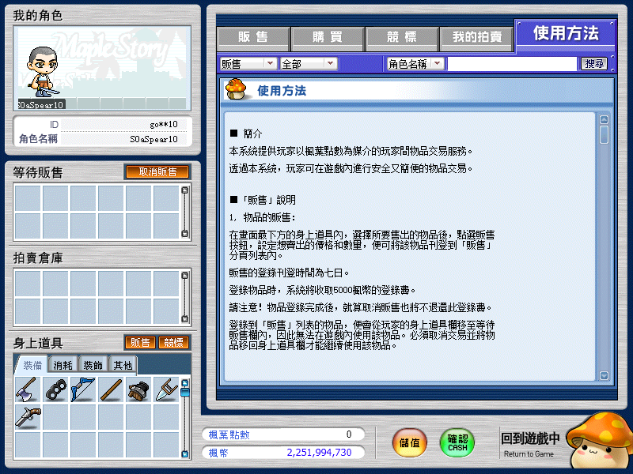
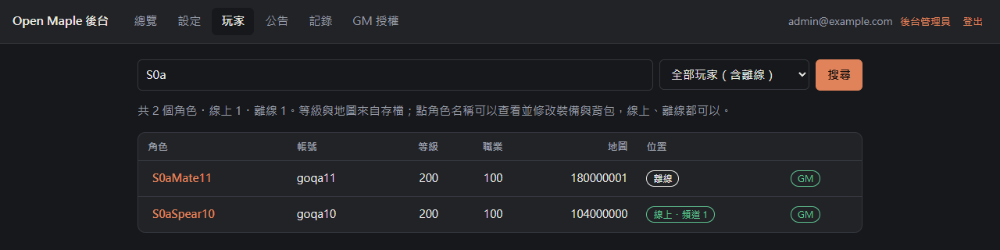
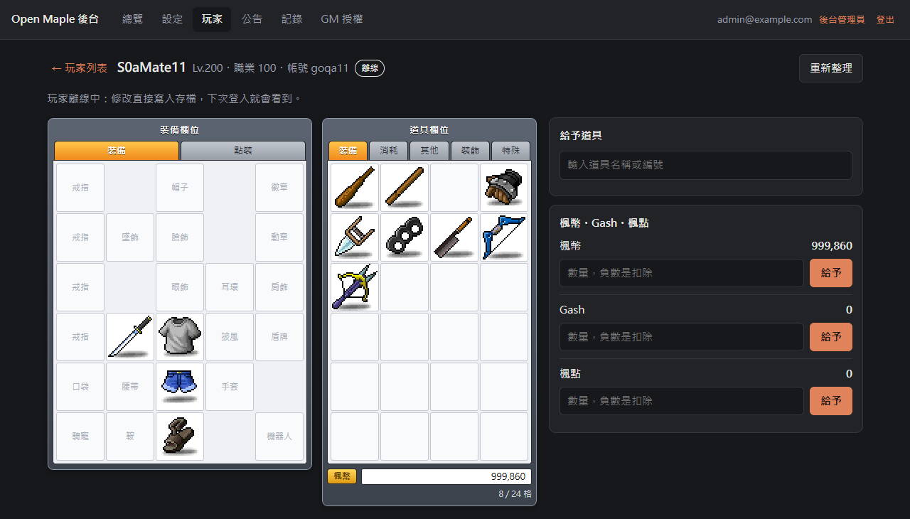
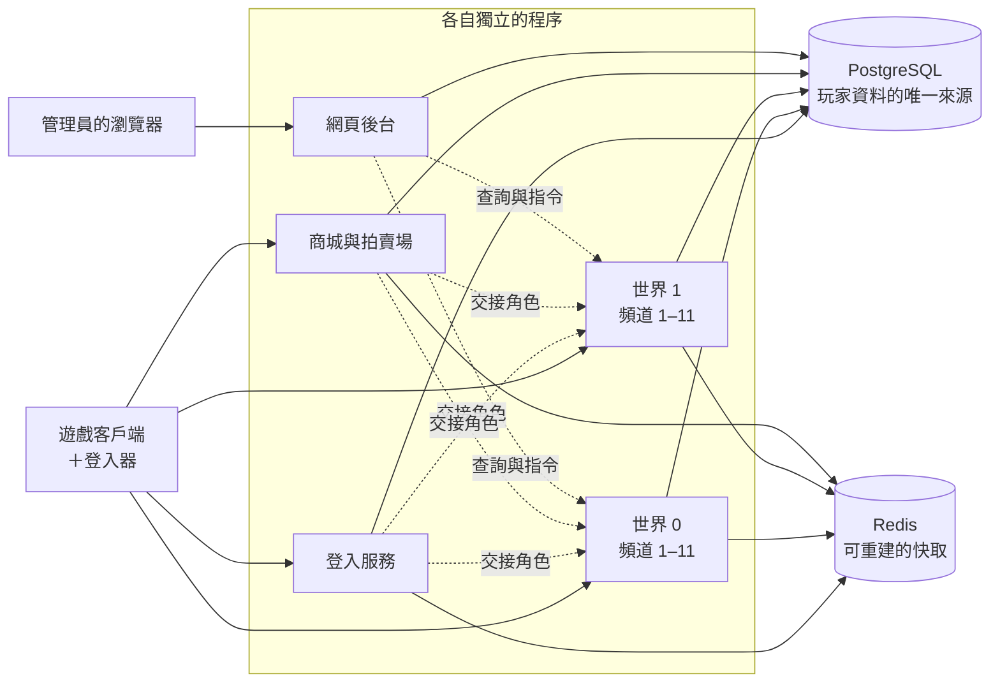

# OpenStory 148 服務器

TMS v148 的遊戲服務器，用 Go 撰寫。資料存在 PostgreSQL，快取用 Redis，NPC／任務／傳點腳本用 Lua。

搭配的登入器：[OpenStory-148-Client](https://github.com/Open-Story-TW/OpenStory-148-Client)。

## 目前支援的功能

下列功能都已實作，並用實際客戶端測過主要流程。

### 帳號與角色

- 登入、第二組密碼、創角、選角，每個世界最多 60 個角色
- 兩個世界，各 11 個頻道；同世界換頻道
- 角色存檔：正常登出、斷線、服務器當機後重啟都保留進度
- 按鍵設定、能力點、背包欄位擴充

### 地圖與戰鬥

- 移動、看見同地圖的其他玩家
- 怪物生成、攻擊、掉寶、經驗值與組隊分配
- 死亡與回城
- 傳點、船、計程車
- 轉職（一轉、二轉）
- 冒險家五個職業的技能：攻擊、Buff、被動、召喚獸
- Buff 重登後保留、同類 Buff 疊加（可開關）

### 道具

- 裝備穿脫、背包整理、丟棄與撿取
- 消耗品（補血、補魔、Buff 藥水）
- 卷軸強化
- 潛能：上潛能、鑑定、重置
- 寵物：召喚、餵食、指令

### 經濟

- NPC 商店
- 帳號共享倉庫
- 玩家交易（可設手續費）
- 精靈商人（可設手續費）
- 宅配
- 拍賣場
- 購物商城：購買、禮物、優惠券、願望清單、點數倉庫

拍賣場：



宅配，送達時間可以在後台調整：


### 社交

- 聊天（一般、隊伍、公會、聯盟）
- 好友、隊伍、遠征隊
- 公會與公會聯盟

### 腳本

Lua 腳本，可以逐行暫停、設中斷點除錯。目前已轉換：

| 類型 | 數量 |
| --- | --- |
| NPC | 125 |
| 任務 | 197 |
| 傳點 | 621 |
| 進入地圖 | 13 |

寫法見 [腳本說明](internal/scripting/README.md)。

### 突破原版上限（需搭配登入器）

等級、能力值、HP／MP、經驗值、楓幣與點數、傷害、公會與好友人數都可以超過原版上限，在後台逐項開關。

### 網頁後台

預設網址 `http://localhost:19090`，說明見 [後台說明](docs/ADMIN.md)。

- 調整倍率（經驗、楓幣、掉寶）與各項功能開關，多數設定幾秒內生效，不用重啟
- 查看與修改玩家的裝備和背包
- GM 授權、公告、即時監控

玩家列表，線上與離線的角色都查得到：



點進角色後可以直接看到裝備與背包，給予或收回道具、楓幣與點數：



## 待實作與待測試

| 項目 | 狀態 |
| --- | --- |
| 副本與 Boss 活動 | 未實作。還沒有副本入場、隔離、重置的框架。 |
| 冒險家以外的職業技能 | 尚未驗收。 |
| 冒險家技能 | 五個職業共 163 個技能已測過大部分項目，還沒有任何一個技能的所有項目都通過。 |
| 潛能效果 | 交易與數值已完成，部分特殊效果（反射、無視傷害等）還沒接上。 |
| NPC、任務、傳點腳本 | 只開放已轉換的腳本，其餘 NPC 點了沒有反應。 |
| 5,000 人同時在線的壓力測試 | 未做。 |
| 從舊服務器搬移玩家資料 | 未做。 |
| 對外營運的部署方式 | 目前只有本機啟動腳本，服務只監聽本機位址。自己的 Tailscale 裝置可以連進來：在 `.local/environment.json` 把 `MAPLEGO_TAILNET_BIND` 設成這台機器的 Tailscale 位址（`100.64.0.0/10`），登入、頻道與商城就會在那個位址多開一份。 |

完整的階段規劃見 [路線圖](docs/ROADMAP.md)。

## 快速開始

需要：

- Windows
- [Go](https://go.dev/dl/) 1.26 以上
- [Docker Desktop](https://www.docker.com/products/docker-desktop/)（用來跑 PostgreSQL 與 Redis）
- v148 的 WZ 資料，已轉成 XML 格式

步驟：

1. 啟動 Docker Desktop。
2. 執行一次 `start-local.cmd`。它會建立 `.local/environment.json`，下載資料庫映像，編譯並啟動所有服務。
3. 開啟 `.local/environment.json`，把 `MAPLEGO_WZ_ROOT` 設成 WZ XML 資料夾的路徑。沒設定時只有內建的新手內容。
4. 執行 `stop-local.cmd` 再執行 `start-local.cmd`，讓設定生效。
5. 把登入器放進 v148 客戶端後啟動遊戲。登入器預設就是連本機的 `127.0.0.1:18484`。

建立測試帳號：

```powershell
powershell.exe -NoProfile -ExecutionPolicy Bypass -File tools\local.ps1 test
```

帳號與密碼會寫在 `.local/client-test.credentials.json`。

常用指令：

| 指令 | 作用 |
| --- | --- |
| `start-local.cmd` | 啟動資料庫、編譯、更新資料表、啟動所有服務 |
| `stop-local.cmd` | 停止服務，資料庫繼續執行 |
| `tools\local.ps1 status` | 查看每個服務是否在執行 |
| `tools\local.ps1 build` | 只編譯 |
| `tools\local.ps1 reload-scripts` | 不重啟，重新讀取腳本資料夾 |

不重啟更新腳本：

1. 在 `.local/environment.json` 加上 `MAPLEGO_SCRIPTS_DIR`，值是一個排列方式和 `scripts` 相同的資料夾（`npc/`、`quest/`、`portal/`、`map/on_user_enter/`、`legacy/`），可以直接指向這個專案的 `scripts` 資料夾。重啟一次讓設定生效。
2. 之後修改或新增 `.lua` 檔，執行 `tools\local.ps1 reload-scripts` 就會生效。

資料夾裡的檔案會蓋過內建的同名腳本，資料夾沒有的腳本照舊用內建版本。語法有錯的檔案會被拒絕並列出原因，伺服器繼續用原本的版本。進行中的對話用舊版跑完，下一次對話才用新版。沒設定 `MAPLEGO_SCRIPTS_DIR` 時只用內建腳本。

以下情況仍然要重新編譯並重啟：新增腳本可以呼叫的伺服器功能、為原本沒有腳本的任務新增腳本、修改 `scripts` 裡的 `.json` 清單。

使用的埠：

| 服務 | 埠 |
| --- | --- |
| 登入 | 18484 |
| 世界 0 的頻道 1–11 | 18485–18495 |
| 世界 1 的頻道 1–11 | 18505–18515 |
| 購物商城 | 18600 |
| 網頁後台 | 19090 |
| PostgreSQL | 15432 |
| Redis | 16379 |

更多細節見 [本機設定說明](docs/LOCAL_SETUP.md)。

## 建置與測試

只編譯，不啟動：

```powershell
go build ./...
```

測試：

```powershell
go test ./...
```

不需要資料庫的測試會直接執行；需要 PostgreSQL 與 Redis 的測試，要先把 `.local/environment.json` 的內容載入環境變數，做法見 [本機設定說明](docs/LOCAL_SETUP.md)。

## 專案結構

| 路徑 | 內容 |
| --- | --- |
| `cmd/login` | 登入服務 |
| `cmd/world` | 世界服務，每個世界一個程序 |
| `cmd/cashshop` | 購物商城與拍賣場服務 |
| `cmd/admin` | 網頁後台 |
| `cmd/migrate` | 資料表更新工具 |
| `cmd/launcherkey` | 產生登入器驗證用的金鑰 |
| `internal/protocol` | 封包格式與加密 |
| `internal/world` | 地圖、戰鬥、道具、社交等遊戲邏輯 |
| `internal/skills` | 各職業技能 |
| `internal/persistence` | 資料庫存取 |
| `internal/scripting` | Lua 腳本執行環境 |
| `scripts` | NPC、任務、傳點腳本 |
| `ent` | 資料表定義與版本化更新檔 |
| `docs` | 設計與說明文件 |

## 架構



玩家先連登入服務，選好角色後被交給所選世界；進商城或拍賣場時再交給商城服務，離開時交回世界。每一次交接都是一張只能用一次的憑證，記在資料庫裡。

### 為什麼比舊的 Java 服務器穩

下表左欄是直接讀舊 Java 服務器原始碼看到的做法。

| 舊的 Java 服務器 | 這個服務器 | 差別 |
| --- | --- | --- |
| 登入、商城、所有世界與頻道在同一個程序裡啟動 | 登入、每個世界、商城、後台各是一個程序 | 一個世界當機或記憶體用盡，只有那個世界的玩家斷線；其他世界、登入、商城照常運作，重啟也只需要重啟那一個 |
| 存檔時把角色的道具、任務整批刪除再全部重寫 | 只寫有變動的那幾筆，每件道具有永久編號 | 存檔的資料庫負擔小很多；存到一半失敗時不會留下「已刪除、還沒寫回」的空窗 |
| 進商城、換頻道靠程序內共用的記憶體傳遞角色 | 交接寫進資料庫，憑證只能用一次 | 交接途中任一邊當機，角色不會消失，也不會同時存在兩邊 |
| 角色名稱在資料庫沒有唯一限制 | 由資料庫保證唯一 | 不會因為同時創角而出現同名角色 |

除了上表的對照，這個服務器還有兩項保護：

- **每個角色同一時間只有一個寫入者。** 世界程序要先取得該世界的寫入權，每次存檔都核對版本號。當機後殘留的舊程序寫不進去，不會用舊資料蓋掉新資料，這是防止回檔與複製道具的基礎。
- **扣除與給予在同一筆資料庫交易裡完成。** 交易、購買、強化不會只做一半：要嘛全部成立，要嘛全部不成立。

### 為什麼能支撐更多玩家

- **角色列表不查完整角色。** 舊服務器列出角色時，每個角色都把整份資料、任務、裝備查一遍。這裡讀一份預先整理好的摘要，第一次讀只要一次查詢，之後直接從 Redis 取。
- **在線角色放在世界程序的記憶體裡。** 移動、戰鬥不需要每次都碰資料庫，資料庫只處理存檔與交易。
- **每張地圖自己排隊處理事件。** 同一張地圖上的攻擊、撿取、怪物行為依序處理，不同地圖互不等待，可以用上多核心。
- **所有佇列都有上限。** 連線太慢的客戶端、塞車的資料庫工作都不會無限堆積，把整個世界拖垮。
- **Redis 掛掉不掉資料。** 它只放可以重建的東西；Redis 重啟時在線玩家不受影響，快取之後自動補回。
- **世界可以分開部署。** 每個世界是獨立程序，人數成長時可以把世界分到不同主機。

### 還沒驗證的部分

設計目標是全服 5,000 人同時在線，但**壓力測試還沒做**，上面是設計上的理由，不是量測結果；舊 Java 服務器在同樣人數下的表現也沒有量測過。另外有幾點要留意：

- 同一個世界的所有頻道在同一個程序裡，世界當機時該世界的頻道會一起中斷。
- PostgreSQL 與 Redis 是所有服務共用的，正式營運時資料庫需要自己的備援與備份。
- 所有服務放在同一台主機時，主機故障仍會一起影響。

細節見 [架構說明](docs/ARCHITECTURE.md)、[資料模型](docs/DATA_MODEL.md) 與 [快取與存檔](docs/CACHE_AND_PERSISTENCE.md)。

## 授權

見 [LICENSE](LICENSE) 與 [NOTICE.md](NOTICE.md)。
