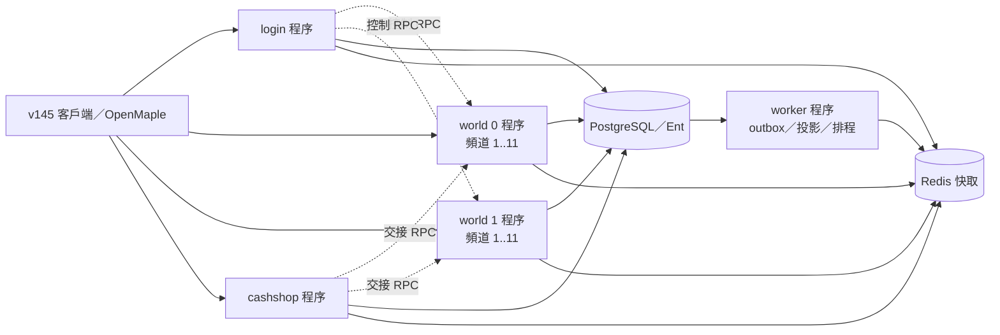

# 架構與故障隔離

## 決策與邊界

採單一 Go repository、共用可版本化套件、多個獨立執行檔。程序間以有期限的 protobuf/gRPC 通訊；遊戲客戶端保留 v145 TCP 協定。一個世界一個活動 `world` 程序，頻道是該程序內的邏輯隔離單位。

圖中的 DB 與 Redis 是共用基礎設施，服務拆分本身不會消除它們的故障風險。正式環境還需要 PostgreSQL 備援／備份、服務資源限制與不同主機的故障隔離。

| 程序 | 責任與持有狀態 | 不應依賴的同步路徑 |
| --- | --- | --- |
| login | 帳密／第二密碼、封鎖、世界列表、角色摘要、選角；創角轉交所選世界 | 已在線玩家的移動或戰鬥不能每包呼叫 login |
| world N | 該世界的角色、地圖、怪物、頻道、隊伍、公會、任務、遊戲資產命令 | 遊戲迴圈不能等待商城或其他世界 |
| cashshop | 商城連線、商品、帳號點數、購買、點裝倉與交付 | 商城展示／購買不能要求原世界持續存活 |
| worker | 可重試 outbox、快取失效、排行榜、非即時維護 | 核心交易提交不能等待 worker 的即時回覆 |

商城可以服務多個世界，所有角色相關請求必帶經驗證的 `world_id`。世界間角色移轉是額外功能，不等同換頻，第一版預設關閉。

## 故障範圍

| 故障 | 預期結果與恢復 |
| --- | --- |
| login 程序終止 | 該程序登入連線中斷；其他登入副本與已在線世界繼續 |
| cashshop 程序終止 | 商城連線中斷；已提交訂單可恢復，世界內遊戲繼續 |
| world 0 程序終止／OOM | world 0 的全部頻道中斷；world 1、login、cashshop 繼續；重啟重新取得寫入權 |
| world 內單一 handler panic | 在可恢復的命令邊界清理該 session／地圖並記錄；共享狀態不可信時讓該 world 結束 |
| Redis 遺失／重啟 | 快取重新建立；以併發限制保護 PostgreSQL；在線角色不須重新載入 |
| PostgreSQL 無法寫入 | 拒絕新交易／交接／選角；在線移動可暫時繼續，保存延遲到上限後停止進度變更並進維護狀態 |
| worker 中斷 | outbox 累積、摘要可能較舊；交易仍可提交；恢復後冪等重播 |

同一世界的頻道共用程序，仍有共同故障範圍。若未來要求「單頻崩潰不影響同世界其他頻道」，必須進一步拆成頻道程序。所有服務放在同一實體主機，也仍會受主機故障一起影響。

## 在線角色與執行模型

1. 每個角色同時只有一個有效 session／寫入者；世界持有遊戲中的角色 aggregate，Ent entity 與 Redis DTO 都不作為在線遊戲物件。
2. 以地圖或地圖分片為單一寫入執行單位，序列化碰撞、拾取、怪物與玩家事件。跨地圖／跨頻道透過有界命令佇列交接。
3. DB、RPC、腳本與檔案 I/O 交給有上限的工作池；返回結果附 actor sequence／epoch，由擁有者檢查後套用。
4. 角色移圖時先從舊地圖撤下，再在新地圖安置；交易涉及多名玩家時使用一致鎖定順序及 PG 交易，不能只依賴各自 actor 的序列化。
5. 頻道、地圖、session 的佇列、封包大小及同時執行工作都有上限；慢客戶端不能堆積無限發送緩衝。

先以標準 Go TCP／goroutine 模型實作，再以 profile 決定網路層或 executor 的替換。地圖數、角色物件大小與腳本成本需要實測。

## 持久化寫入權：租約與 fencing

Redis 只提供可重建的 presence／世界索引。真正寫入權在 PostgreSQL：

- `ops_runtime_leases`：每個世界一筆活動世界租約，包含 instance、遞增 epoch、PG 時間的到期點。初始規劃每 5 秒續約、20 秒到期，須以故障測試調整。
- `ops_character_ownership`：角色對應的 world、instance epoch、session generation 與狀態。
- `ops_account_sessions`：一帳號一筆活動 session，防止同帳號跨世界／商城雙登入；商城中的角色不接受世界遊戲命令。
- 租約以程序為單位續約，避免為 5,000 名玩家逐筆更新心跳。角色所有權只在登入、交接、斷線時改變。

所有角色／資產寫入交易先在同一 PG transaction 內取得租約的共享列鎖，驗證 epoch、到期與 session，再檢查角色所有權；接管以互斥更新遞增 epoch。多筆正常交易可同時持有共享鎖，不能讓每筆保存都互斥鎖住同一世界列。交易要短、有期限，不能持鎖呼叫網路。

續約失敗時世界使用單調時鐘的本地保守期限停止接收變更；最終 PG fencing 阻止暫停後恢復的舊程序覆寫新程序。`recover` 或 Redis 分散式鎖都不能替代這個機制。必測舊程序恢復、網路分割、租約到期與接管的競態。

## 登入、換頻與商城交接

**登入選角**：login 驗證帳號 → 讀角色摘要 → 驗證角色歸屬與世界可用 → 建立短效交接紀錄 → 客戶端重連所選世界 → 原子消費交接／取得 session generation → 載入選中的角色。

**同世界換頻**：角色持有同一 world 程序內的狀態；凍結舊 session → 完成必要的持久提交 → 轉移 map／channel ownership 與新 session generation → 客戶端重連新頻道 → 一次性接續。Buff／冷卻以截止時間交接。成功換頻不做全角色 reload 或整包重寫；失敗／逾時可回到已提交 checkpoint。

**世界進商城**：世界停止接受該角色命令、完成 checkpoint → 在 PG 建交接與轉移 account session → 世界撤下角色並放棄遊戲寫入權 → cashshop 消費交接。商城持有展示用角色資料及商城資產權限，沒有任意重寫角色技能／任務的權限。

**商城返回世界**：完成訂單／資產移轉 → 建立返回交接 → 世界取得新 generation／ownership、讀取需要的已提交元件 → 進地圖。世界先前仍存活時可用受 revision 驗證的凍結物件減少讀取；冷恢復須可直接由 PG 完成。

**交接安全契約**：一次性、短效、綁定帳號／角色／來源與目的程序／generation；以 PG 原子消費，RPC 重試具有同一 operation ID。IP／MAC 僅作輔助訊號，不能代替票券。P0 必須確認 v145 的既有登入欄位能否承載不可猜測憑證；若不足，於 OpenMaple 增加有版本的交接擴充並驗證。擴充 opcode 必須先盤點既有 `0x600..0x603`，避免衝突。此相容性驗證是對外部署的必要條件。

資產跨商城／世界移轉使用同一 PG transaction 更新唯一物品的 container／owner，並記錄交付；不能兩邊各產生一件「副本」。

## 服務間通訊與部署

- RPC 契約至少有 `request_id`、`operation_id`、schema version、來源 instance、world、account、character、session generation、deadline；信任只來自已驗證服務身分。
- 內部 RPC 私網部署與 mTLS；只重試可安全重試的命令，採 deadline、有限次數、退避與熔斷，避免依賴故障擴散。
- 世界／頻道目錄是可快取的 read model，來源是 PG 註冊與租約；現存世界連線不因 login 或目錄服務暫時失效而斷線。
- 第一版不增加所有遊戲流量必經的中央 gateway。v145 客戶端依既有 IP／port redirect 直連目標 listener。
- Go 隔離開發端口建議 login `18484`、world 0 `18485..18495`、cashshop `18600`；world 1 使用另一組連續端口，實作前檢查占用。正式 advertised address／端口以配置為準。
- 同世界同時僅一個活動程序。部署採 draining → checkpoint → 釋放租約 → 新程序接管；其他世界可分別更新。第一版不承諾無斷線熱遷移。
- readiness 表示可接新玩家，liveness 表示程序運行；外部 Redis／DB 短暫失效不應觸發所有程序反覆重啟。
