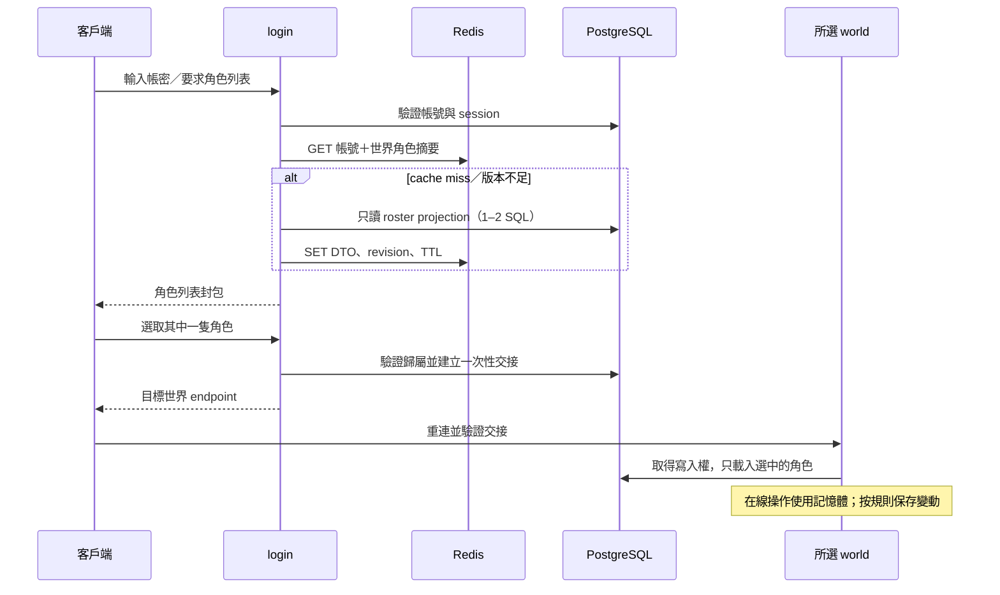

# 快取、在線狀態與保存一致性

## 三層資料分工

| 層 | 保存什麼 | 更新／失效 | 遺失後 |
| --- | --- | --- | --- |
| L1：world 記憶體 | 該世界正在遊戲的角色、地圖、Buff／冷卻、待保存增量 | 單一寫入者即時更新；斷線／交接凍結並保存 | 從 PostgreSQL 恢復已提交狀態；一般進度有明確 RPO |
| L2：Redis | 角色列表摘要、展示用商品、排行榜、可重建 presence／世界目錄 | commit 後失效、outbox 補償、版本／TTL | 冷載入與重建，限制回源併發 |
| L3：PostgreSQL | 帳號、完整持久角色元件、唯一資產、餘額、訂單、權限及交接 | Ent／受限 SQL transaction | 依備份／WAL／備援恢復 |

靜態技能、道具、掉落與 WZ 地圖定義於建置期轉成有 manifest／checksum 的不可變內容包，各 world 載入本地記憶體。它們不需要在每次打怪時讀 DB 或 Redis。

## 角色列表：消除讀取放大

Java 的查詢放大已由原始碼確認，實際耗時與 DB QPS 尚未量測。角色摘要是獨立 read model，包含 v145 角色列表封包實際需要的欄位；任務內容、全部背包、技能等留待選角後載入。

第一版選角的完整 aggregate 從 PostgreSQL 做一次受控冷載入，取得一致版本。上線後，同世界移動與換頻使用 L1；跨程序交接可以只讀必要元件。離線完整角色快照的 Redis 快取列為後續實測優化：必須驗證 PG revision、codec、大小與失效規則後才啟用。

## Redis key 與用途

| Key 範例 | Payload／TTL 起點 | 正確性要求 |
| --- | --- | --- |
| `mgs:{a:42:w:0}:roster:v1` | 有 schema／summary revision 的摘要；20–30 秒 jitter | 可短暫落後；選角重新驗證 PG 歸屬／狀態 |
| `mgs:catalog:v1:<content-version>` | 不可變展示內容；版本鍵，舊版有限 TTL | 購買價格、資格、限量以交易內檢查為準 |
| `mgs:presence:w:0:c:123` | 目的服務、channel、generation；約 15 秒 TTL | 可漏／可舊；接收端仍驗證 session generation |
| `mgs:directory:v1` | 世界 endpoint／容量；約 5 秒 TTL | PG runtime lease 是來源，不能僅憑快取接受過期世界 |
| `mgs:rank:w:0:<board>:v1` | ZSET／查詢投影；可重建 | 排名延遲可觀察，不能當作資產餘額 |

key 帶環境前綴以區分 dev／staging／prod。Redis hash tag 僅在需要同 slot 多 key 操作時設計，不把整個世界放在同一個 hash slot。DTO 只包含必要欄位，限制 payload 大小、解碼深度及 schema version，不能直接序列化帶 connection／mutex／Ent edges 的遊戲物件。

第一版 Redis 作為可淘汰的 cache instance，設 `maxmemory` 與經量測選定的 LFU／LRU 策略。帳密、唯一寫入權、未提交資產、可靠事件不以此 instance 為唯一儲存。若日後使用 Redis 保存必須存活的短期狀態／Streams，需另分 instance 與持久化／eviction 政策；不同 logical DB 無法隔離記憶體淘汰。

## Cache-aside 與失效

1. world 修改摘要相關欄位時，在同一 PG transaction 更新持久狀態、roster read model／revision 及 outbox。
2. commit 後立即 best-effort 刪除摘要 key；worker 重試 outbox 失效。創角等讀自己剛寫的流程帶最小 revision，版本不足時直接回源。
3. cache miss 以帶 deadline 的 SQL projection 讀取，再保存版本化 DTO；快取內已有較新 revision 時拒絕較舊值覆蓋。
4. TTL 保留隨機抖動；空角色列表可短期快取，創角成功會失效。驗證密碼與封鎖等授權結果不混入 roster cache。
5. 使用 per-key `singleflight`、全程序／每 DB 的回源 semaphore、回源 deadline。跨程序的 cache-fill lock 只減少重複查詢，不提供資產鎖定。

commit 後 `DEL` 與並行 cache fill 仍有舊值晚到的競態；outbox 也不是即時跨儲存交易。第一版接受摘要展示的短暫落後，界限包含最多 30 秒 TTL 與受限 fill deadline；選角、購買、刪角和寫入授權都重新讀取權威資料。不能把這套失效流程描述為完整角色的強一致快取。

Redis Pub/Sub 可用於可遺失通知；可靠交付與交易事件以 PG outbox／receipt 保證可重試。官方說明 Pub/Sub 是 at-most-once，離線訂閱者會漏訊息，見 [Redis 文件](https://redis.io/docs/latest/develop/pubsub/)。

## 增量保存

每個角色按 progress、quests、skills、settings 等元件記錄 dirty field／row 與 actor sequence。保存工作抓取不可變 patch，帶 `expected_revision`、runtime epoch 與 session generation。

- 一般進度以約 5 秒錯開排程及單角色合併保存為起點；不是每個頻道同一秒存全部角色。
- 只 upsert／delete 改變的任務、技能與設定；保留未變的列，避免整張角色子表刪掉重寫。
- 一名角色最多一筆同類 checkpoint 在途；commit 回來只清除該 sequence 以前已保存的 dirty 標記，後續變更保留。
- revision 衝突不能強制覆寫；重新核對已提交經濟命令／角色元件後重試有效 patch，避免舊快照蓋掉新交易。
- 同世界成功換頻沒有完整角色讀寫；必要提交及 pending reconnect 狀態由同一 world 管理。
- 斷線／部署時做有期限的 drain。斷線錯誤不能被無限重試佇列掩蓋；保存失敗須產生可追蹤事件。

最壞情況 5,000 個角色每 5 秒都變髒，約為每秒 1,000 個角色 checkpoint，尚未包含經濟命令。這只是負載公式，需透過批次提交、元件合併與實際 PG 測試驗證。程序租約心跳採批次／每程序一筆，避免同時增加 5,000 個 DB 心跳。

## 哪些操作要先持久化

| 資料／操作 | 保存／回覆規則 |
| --- | --- |
| 點數扣款、物品增減／移轉、交易、強化、獎勵領取 | ledger／資產／資格在 PG 同交易提交後才回覆成功；重試冪等 |
| 任務完成、升級或活動導致資產獎勵 | 進度門檻與獎勵一起提交，避免進度回退後再次領取 |
| 普通經驗／任務擊殺計數、HP／MP／位置與偏好 | 合併 checkpoint；明確允許有限進度回退，不用於複製資產 |
| 移動動畫、怪物瞬時位置／仇恨、封包佇列 | 記憶體資料；重啟的重建／副本補償規則逐功能定義 |
| 怪物掉落／楓幣獎勵的高頻寫入 | 可做短時間 group commit／批次 ledger；回覆成功仍須等待持久提交，不能先 ACK 再丟進 Redis |

若實測要求更低的進度 RPO，可以加 durable progress journal 再異步物化 checkpoint。這會增加 WAL／儲存成本，列為容量測試後的選項，第一版不引入全量 event sourcing。

## RPO 與故障降級目標

- 已成功回覆的資產／訂單：在 PG 持久提交與程序崩潰的範圍內，以 RPO 0 驗收；同步備援／儲存層故障另行驗證，非同步 replica 不自動提供相同承諾。
- 一般進度：初始目標回退不超過 10 秒，包含排程與 queue／DB 延遲；不是尚未測試的保證。保存 lag 超限就停止新增持久進度，避免無界回檔。
- Redis 完全清空：資產損失 0；新登入／列表以限流與回源降級，在線地圖狀態保持。
- PG 無法寫入：新交易、轉移與創角明確失敗／可查未決結果；已在線玩家最多在規定寬限內活動，不累積無界待保存資料。

必測 crash at commit、commit 回覆遺失、快取先刪後舊值回填、worker 重播、舊 session 寫入、保存中又有新變更，以及交易與 checkpoint 交錯。
