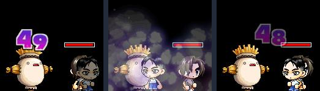

# v148 技能稽核進度（2026-11-18）

已有 **261／1,502 項技能**完成驗收（**17.4%**）。清單共 **2,817／16,298 個檢查點**通過，已收錄 **5,245 張原版實機截圖**。

先前列出的戰士五項技能共 **47／47** 個檢查點通過，包含 HP 增加、守護拳套防具、自身強化、魔天一擊與劍氣縱橫。近期實機驗收也完成煙幕彈、雙飛斬與四飛閃。

## 煙幕彈接觸傷害

在 r54 測試環境以 v148 原版客戶端進行隔離實測。角色在煙幕內與怪物持續重疊約 **8.59 秒**，期間接觸傷害為 **0**。煙幕自然消失後，同怪物的接觸傷害恢復。

