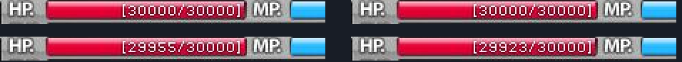

# 進階藍色繩索實機驗收（2026-11-18）

**275／1,502 項技能（18.3%）**完成驗收，**2,986／16,298 項檢查**通過。本機收錄 **5,343 張原版 v148 實機截圖**。

進階藍色繩索（32110000）在私有候選通過清單三項。滿級啟用後，兩端顯示正確的進階繩索和物防、魔防加成。同一原版怪物碰撞時，原始傷害為 127，分攤 50 並吸收 5。施術者實扣 45，隊友實扣 77。

下圖左側是施術者，右側是隊友。上排為碰撞前，下排為碰撞後。隊友自行點擊圖示取消仍待驗。

雙弩槍精通、手杖精通、精準之弩、精準雙刀本輪也各完成三項。每項均留存兩把合法武器與原版客戶端重啟後的面板截圖。

施術者用原版熱鍵取消，兩端圖示均清除。重新施放後，隊友切換地圖會清除自己的效果，同場施術者保留效果。
