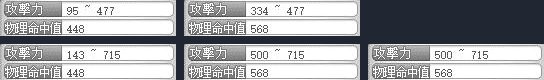

# 龍騎士武器精通驗收（2026-11-18）

**264／1,502 項技能（17.6%）**完成驗收，**2,957／16,298 項檢查**通過，累計收錄 **5,287 張原版實機截圖**。自上次發布後多驗收 38 項 Buff 檢查，以及龍騎士武器精通（1300000）的三項檢查。

原版 v148 比對兩把合法武器。學習滿級後兩把武器的物理命中值均由 448 增至 568。第一把的攻擊範圍由 95–477 變為 334–477，第二把由 143–715 變為 500–715。完整重啟原版客戶端後，第二把維持 500–715、物理命中值 568。

截圖上排是第一把武器，下排是第二把。由左至右依序是學習前、學習後、重登後。

