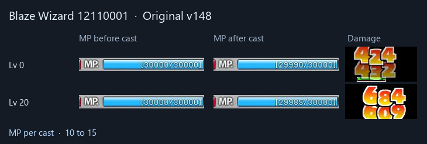

# 烈焰巫師魔力激發原版驗收（2026-11-19）

**283／1,502 項技能（18.8%）**完成驗收，**3,038／16,298 項檢查**通過，清單收錄 **5,397 張原版 v148 實機截圖**。

烈焰巫師魔力激發（12110001）通過全部三項驗收。角色以相同裝備施放同一法術，學習 Lv 20 後單次耗魔由 **10** 增至 **15**。圖中的每發兩段普通傷害分別為 **432＋424** 與 **609＋684**，皆與伺服器逐段實扣一致。第二把合法武器與冷重登後也確認效果。

