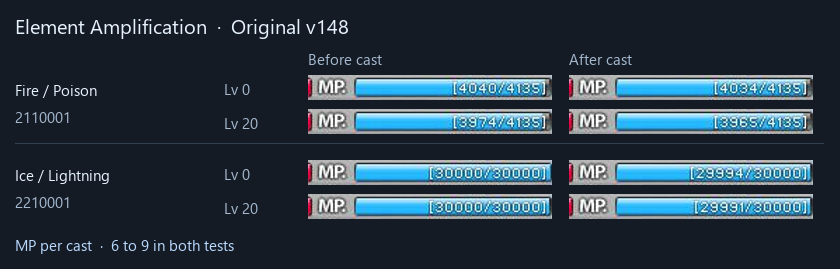

# 火毒與冰雷的魔力激發原版驗收（2026-11-19）

**282／1,502 項技能（18.8%）**完成驗收，**3,035／16,298 項檢查**通過，清單收錄 **5,388 張原版 v148 實機截圖**。

火毒（2110001）與冰雷（2210001）的魔力激發均通過三項驗收。魔力激發 Lv 20 讓同一法術單次耗魔從 **6** 增為 **9**。同一把武器的普通傷害提高，實機顯示與伺服器逐段實扣一致。換用第二把合法武器，並完全關閉客戶端後重登，均再次確認效果。

圖中為兩個職業各自在 Lv 0 與 Lv 20 施放前後的原版 MP 顯示。

