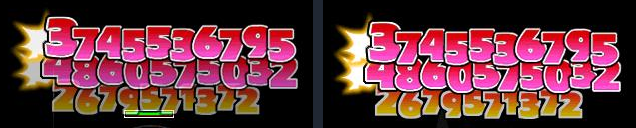

# 聖光原版長傷驗收（2026-11-19）

**280／1,502 項技能（18.6%）**完成驗收，**3,024／16,298 項檢查**通過，清單收錄 **5,368 張原版 v148 實機截圖**。

聖光（2311004）最後一項長傷旁觀爆擊已在啟用旁觀配色的隔離候選通過。施術端及旁觀端同一擊都顯示 **2,679,571,372** 普通傷害，以及 **4,860,575,032、3,745,536,795** 兩段爆擊。Go 實扣為 **11,285,683,199**。

圖左為原版施術端，圖右為原版旁觀端。新舊啟動器共存與正式基底重驗仍在進行。

