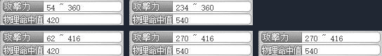

# 武器精通原版重驗（2026-11-19）

**280／1,502 項技能（18.6%）**完成驗收，**3,003／16,298 項檢查**通過。目前清單收錄 **5,352 張原版 v148 實機截圖**。

本輪完成蒼龍俠客精通槍法、聖魂劍士精準之劍、惡魔殺手武器精通、米哈逸精準之劍、重砲指揮官精通加農砲。後四項以沒有其他武器精通的隔離角色重測，每項使用兩把合法武器和一次完整重啟原版客戶端。滿級均增加 50 個百分點的熟練度和 120 點物理命中。

加農砲截圖上排為第一把，下排為第二把。由左至右是學習前、學習後與重登後。第二把的攻擊範圍從 62–416 提升到 270–416，物理命中從 420 提升到 540，重登後保留。

槍手精通槍法和刺客精準暗器也已驗完面板與重登，彈丸或飛鏢容量效果仍待實機驗。
