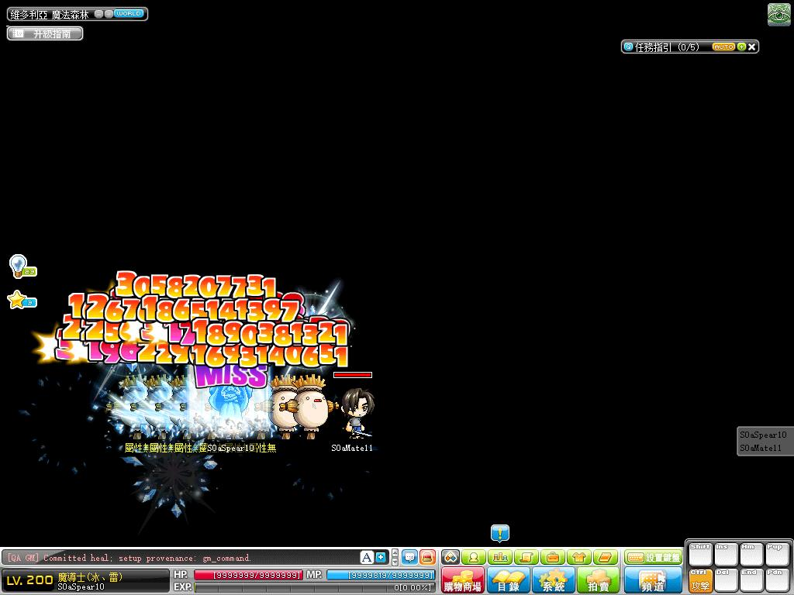

# 劍士、法師、弓箭手線第一批結果（2026-11-20）

全清單完成 **3,574／16,298 個檢查點（21.9%）**，比上一批的 3,328 增加 246 個。全部檢查完成的技能維持 **292／1,502 項**。

| 職業 | 本批前 | 本批後 |
| --- | ---: | ---: |
| 英雄 | 139／331 | **201／331（60.7%）** |
| 聖騎士 | 126／309 | 150／309（48.5%） |
| 黑騎士 | 100／383 | 113／383（29.5%） |
| 火毒魔導士 | 124／392 | 156／392（39.8%） |
| 冰雷魔導士 | 112／389 | 150／389（38.6%） |
| 主教 | 132／419 | 154／419（36.8%） |
| 箭神 | 114／406 | 152／406（37.4%） |
| 神射手 | 122／399 | 166／399（41.6%） |

## 本批內容

- 8 個職業共 219 項待確認畫面的檢查點逐張看圖，判定通過。內容包括傷害數字、旁觀者看到的畫面與 Buff 圖示。
- 楓葉祝福、會心之眼、極速武器與神聖之火的效果，改為直接比對原版客戶端與服務器的數值。神聖之火依原版的百分比與 HP、MP 上限判定。

測試世界中也修正兩項熟練度問題，服務器修正尚待合併至正式版，屆時另行公告：

- 主教「神聖集中術」學會後，熟練度取代魔法精通（50→65），與原版相同。
- 聖騎士「屬性強化」的熟練度只在屬性攻擊期間生效，並取代武器精通，不再常駐疊加。

## 原版實機截圖

逐項結果與全部截圖收錄於登入器儲存庫 v0.1.9 的技能測試清單。
