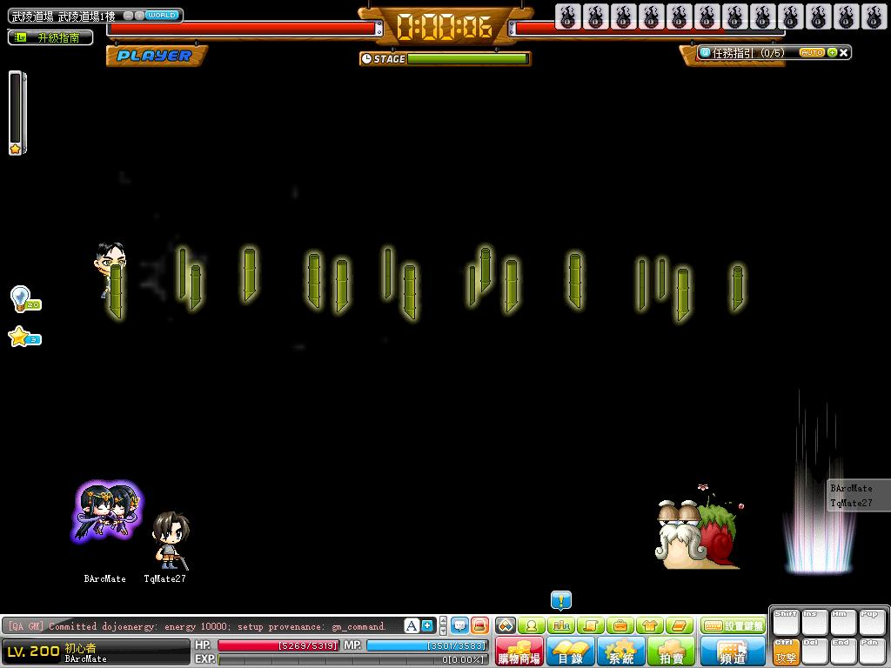

# v148 技能稽核突破 45.0% 里程碑（失敗降至 208、武陵竹雨與魔族之翼畫面過關）（2026-11-21）

全清單正式突破 **7,308／16,235 個檢查點（45.0%）**（7,243 項通過、65 項依清單規則判定不適用），**349／1,502 項啟用技能（23.2%）**的所有檢查都已完成，累計 **1,010 項技能**具自動化實機證據；未通過降至 **208 項**（正式跌破 210），待確認畫面降至 **650 項**。完整逐項清單已收錄於登入器 v0.1.37 的 `docs/server/skill-audit/`。

## 45% 里程碑摘要

- **第三輪第 2 批（閃雷悍將／狂狼勇士／龍魔導士，+34 通過、-6 失敗）**：28 項畫面確認與 6 項失敗轉通過全數零失敗，閃雷悍將躍升至 **43.5%**（失敗 14 -> 11）、狂狼勇士 **43.4%**（失敗 8 -> 5）、龍魔導士 **49.3%**。
- **第三輪第 3 批（+21 通過、0 失敗）**：
  - **武陵道場「竹雨」（`*1009`）**：6 職系雙端黑幕落竹動畫與 30% Boss 扣血確認通過 12 項。
  - **天使祝福戒指 72／72 零失敗**：補齊最後 1 項子 Buff `20020088` 畫面通過。
  - **魔族之翼／特化魔族之翼（`30011109`／`30011159`）**：實機騎寵旁觀與重登保留 6 項畫面通過；各系新手推進至 **24.4%**（875／3,583）。

